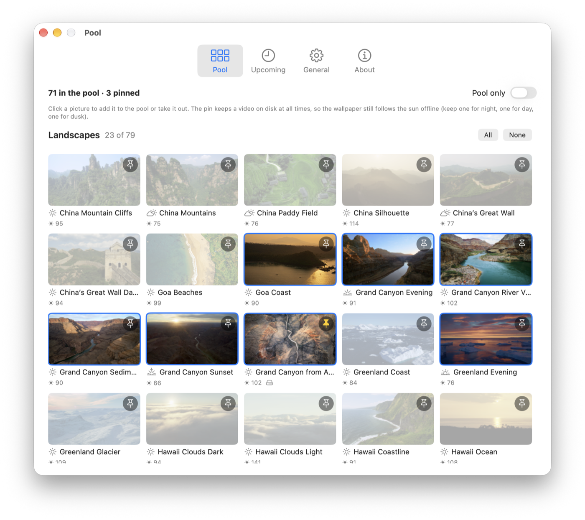
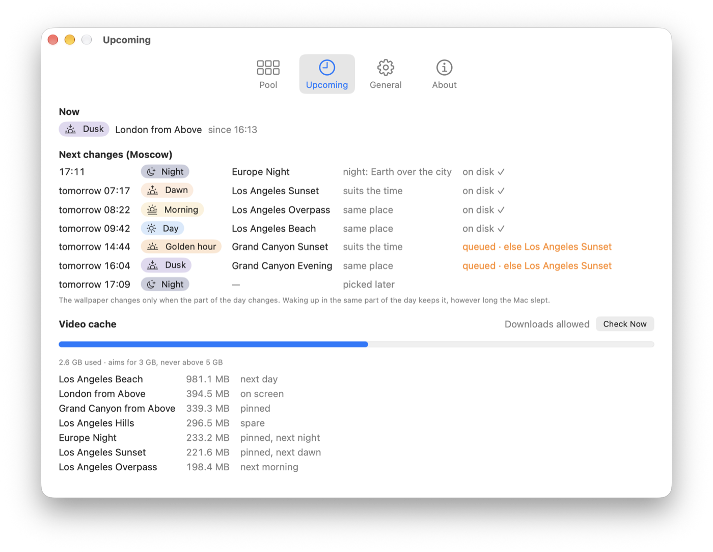
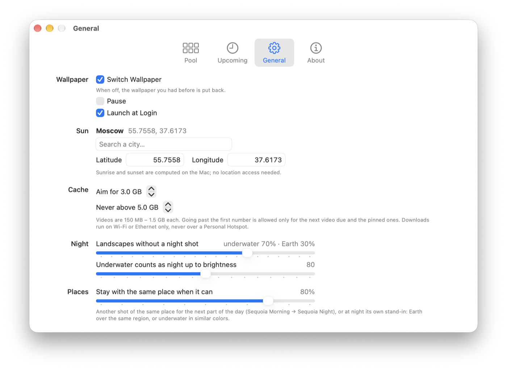

<p align="center">
  
</p>

<h1 align="center">Aerial Rotator</h1>

<p align="center">
  macOS Aerial live wallpapers from <b>your own pool</b>, changing with <b>the sun</b>.<br>
  A menu bar app for macOS 26+. Free and open source (MIT).
</p>

<p align="center">
  <a href="https://github.com/alexlegoshin/aerial-switcher/releases/latest"><b>Download</b></a> ·
  <a href="#how-it-chooses">How it chooses</a> ·
  <a href="#building-from-source">Build</a>
</p>

<p align="center">
  
</p>

---

macOS ships dozens of Aerial videos (landscapes, cities, underwater, Earth from orbit) but only rotates them by
category or at random. Aerial Rotator lets you pick the ones you like and shows each at the right time of day:
a sunset at sunset, a night city or Earth at night, a bright coast at noon. It downloads what is coming next ahead
of time, on Wi-Fi only, and keeps the video folder small.

It started as a fork of [Aerial Switcher](https://github.com/YnNJU/aerial-switcher) by YnNJU, which switches one
day-cycle set (Tahoe, Sequoia…) at fixed hours. The wallpaper store handling comes from there; the rest is new.

## Features

- **Your own pool.** A gallery of every Aerial in the macOS manifest. Click to add or remove; new Aerials that
  Apple ships show up by themselves.
- **Changes with the sun, not the clock.** Sunrise and sunset are computed on the Mac for your city (NOAA solar
  algorithm, about a minute of accuracy; no location access). The day is split into night, dawn, morning, day,
  golden hour and dusk, and **the wallpaper changes only when the part of the day changes**. Wake the Mac a day
  later in the same part of the day and the wallpaper stays.
- **Real sunsets near the horizon.** Dawn, golden hour and dusk prefer shots named *Sunrise*, *Sunset* or
  *Evening*, then twilight shots with a warm palette. Night never gets a daytime shot.
- **Night stand-ins that make sense.** A city without a night shot gets an Earth flight over its region
  (London → Europe at night). A landscape without one gets dark underwater footage in similar colors or an
  Earth flight over its region (70 / 30 by default).
- **Stays with a place.** The next part of the day continues the same place when it can
  (London from Above → London Evening → Europe Night), for at most three parts of the day in a row, then moves on; a video doesn't come back soon after it was shown.
- **Downloads ahead, politely.** The video for each coming part of the day is chosen in advance and fetched in
  order. Wi-Fi or Ethernet only: never over a Personal Hotspot or in Low Data Mode. Background network and disk
  priority, streamed to disk (about 40 MB of memory).
- **A small, byte-based cache.** The cache is the macOS Aerial folder itself, no copies. It aims for 3 GB and never
  goes above 5 GB (both adjustable); going past the first is allowed only for the next video due and pinned ones.
  The video on screen, in the screen saver, or pinned is never deleted.
- **Pins for offline days.** Pin a night, a day and a dusk video and the wallpaper keeps following the sun without
  a network.
- **Hard to break.** Interrupted downloads resume (HTTP `Range` + `If-Range`); a video reaches the macOS folder only
  complete, size-checked and verified playable, by an atomic rename. If the chosen video isn't ready, a downloaded one
  that suits the time stands in until it is; if none does, the wallpaper is left alone. Turning switching off puts
  back the wallpaper you had before.

<p align="center">
  
</p>

## Installation

Requires macOS 26 or later on Apple silicon.

1. Download `AerialRotator-x.y.z.zip` from [Releases](https://github.com/alexlegoshin/aerial-switcher/releases/latest)
   and unzip it.
2. Move **Aerial Rotator** to Applications and open it.
3. The app is ad-hoc signed, not notarized, so macOS may block the first launch: go to
   **System Settings › Privacy & Security** and click **Open Anyway**.
4. Pick your Aerials in **Pool**, set your city in **General**, turn on **Launch at Login**.

Opening the app again while it runs shows Settings, in case the menu bar icon is hidden behind the notch.

## How it chooses

| Part of the day | Sun | Gets |
|---|---|---|
| Night | below −6° | shots named *Night*, Earth flights, underwater up to a brightness threshold |
| Dawn | rising, −6° … +2° | *Sunrise*, *Sunset*, *Evening*, warm twilight shots |
| Morning | rising, +2° … day threshold | *Morning*, bright shots |
| Day | above the day threshold* | *Day*, bright shots |
| Golden hour | setting, day threshold … +2° | *Evening*, *Sunset*, warm twilight shots |
| Dusk | setting, +2° … −6° | *Sunset*, *Evening*, *Sunrise*, warm twilight shots |

\* 60 % of the day's highest sun, kept between 6° and 15°, so a northern winter still has a day.

A video's look comes from the last word of its name when it has one, otherwise from its thumbnail: brightness
(below 55 night, below 80 twilight, else day) and a hue histogram for palette and warmth.

Each pool video is a ticket. A drawn ticket stands for the best shot of its place for the part of the day,
otherwise (at night) for its stand-in. Recently shown videos and places get fewer tickets; with a set chance
(80 %) the next part of the day continues the previous place instead. Choices are deterministic for a given seed,
so a restart doesn't reshuffle what is already downloaded.

<p align="center">
  
</p>

## Building from source

Command Line Tools are enough; Xcode is not needed.

```bash
git clone https://github.com/alexlegoshin/aerial-switcher.git
cd aerial-switcher
zsh scripts/bundle.sh --install   # builds, copies to /Applications and opens it
```

Without `--install` it only builds: the app goes to `.build/bundle.noindex/` (kept out of Spotlight) and a zip to `dist/`.

Universal build: `ARCHS="arm64 x86_64" zsh scripts/bundle.sh`.

### Tests

101 tests in Swift Testing. With Command Line Tools only, the testing macro plugin needs its path:

```bash
swift test -Xswiftc -plugin-path -Xswiftc /Library/Developer/CommandLineTools/usr/lib/swift/host/plugins/testing
```

They cover the solar clock (checked against published Moscow sunrise/sunset times, polar day and night), choosing
(no daytime shot at night, normalized night weights, palette matching, regions, sunsets near the horizon, novelty),
the change-only-when-the-part-of-the-day-changes rule, stand-ins, the cache policy, resumable downloads (range,
changed file on the server, server ignoring ranges, unplayable file), the network policy, the wallpaper store, and
end-to-end runs on a temporary home folder.

## Files

| Path | What |
|---|---|
| `~/Library/Application Support/AerialRotator/config.json` | pool, pins, city, cache limits, weights |
| `…/state/rotation.json` | what is on screen and for which part of the day, the next picks, history |
| `…/state/Index.original.plist` | your wallpaper from before the app, restored when switching is turned off |
| `…/state/metrics.json` | thumbnail brightness and palette (re-measured only when a thumbnail changes) |
| `…/downloads/` | partial downloads and their notes, for resuming |
| `…/logs/rotator.log` | log, 1 MB × 3 |
| `~/Library/Application Support/com.apple.wallpaper/aerials/videos/` | the videos (the cache) |

Every state file is written atomically and can be lost safely: the app rebuilds it, losing only history.

## How it works under the hood

macOS keeps wallpaper choices in `com.apple.wallpaper/Store/Index.plist`. An Aerial is a choice with provider
`com.apple.wallpaper.choice.aerials` and `{assetID}` as its configuration; `WallpaperAgent` picks up changes when
restarted. This format is not a public API and may change with macOS updates; the app reads the store defensively,
backs it up before the first change and never writes a choice for a video that isn't on disk.

The videos are Apple's, downloaded from Apple's servers exactly as System Settings does, into the folder macOS plays
them from. The app doesn't ship or redistribute any of them.

## Credits and license

Aerial Rotator by Alexey Legoshin, based on [Aerial Switcher](https://github.com/YnNJU/aerial-switcher) by YnNJU
(including the app icon and the wallpaper store code). MIT License, see [LICENSE](LICENSE).

Aerial videos, thumbnails and their names belong to Apple and are not covered by this license.
